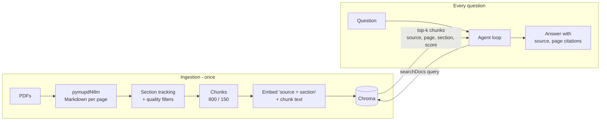

# Agentic RAG over Research Papers

A question-answering agent over three research papers (ReAct, RAG, Toolformer). Retrieval is a tool the agent decides when to use: it writes its own search queries, searches again when results are not enough, and answers with page-level citations. The agent loop is the hand-written one from my [tool-calling agent](../tool-calling-agent) project; this project adds the retrieval side.

## How it works

**Stack:** Python, Claude Haiku 5.5, `pymupdf4llm`, `langchain-text-splitters`, `sentence-transformers` (`all-MiniLM-L6-v2`, local GPU), Chroma

## Results

Eval set of 14 questions: single-paper facts, numbers from tables, figure captions, formula-heavy methods, cross-paper comparison, a borderline general concept, and out-of-scope questions.

| Check | Score |
| --- | --- |
| Retrieval: an expected page was retrieved | 14/14 |
| Answer: required facts present, no false citations | 13/14 |
| Total cost (14 questions) | $0.0093 |

The one failure is a grounded but incomplete answer: the agent found four downsides in the abstract and stopped, missing the one in the introduction on the same page.

## Key findings

- **Look at the extracted text.** Some figures in the ReAct PDF extract as shifted characters (`$FW` = `Act`) because of a missing font mapping. A stopword-ratio filter removes them; no library flags this on its own.
- **Re-check thresholds when the pipeline changes.** Switching PDF readers let reference lists pass the old filter, and they took 4 of the top 5 results for some queries. Section-based filtering plus a structure check (list items with years) fixed it.
- **Reading order is not logical order.** In a two-column layout a section heading was read in the middle of the references, so a rule based on "last heading seen" mislabeled pages. Two independent filters cover each other.
- **Pure chunks lose context.** Splitting by section removed the word "RAG" from the retriever section and it dropped out of the results. Prepending `source > section` to the embedded text brought it back.
- **The agent layer fixes some retrieval weaknesses.** Vector search always returns results, even for "best pizza in Naples"; the agent answers "not covered" without searching. Multiple searches also recover sections a single search misses.
- **More searching costs more.** A rule to search again before reporting a gap filled two missing points in a comparison answer, at about twice the tokens. Parallel searches in one turn cut tokens by about 40%.

## Limitations

- Retrieval is scored at page level, so it cannot tell which chunk on a page was used; the 14/14 score is generous.
- An agent cannot search for a gap it does not notice (see the failed question above).
- Answer checks use keywords and cannot judge completeness or quality.
- Formula-heavy sections embed poorly; reranking or a stronger embedding model were not tested.
